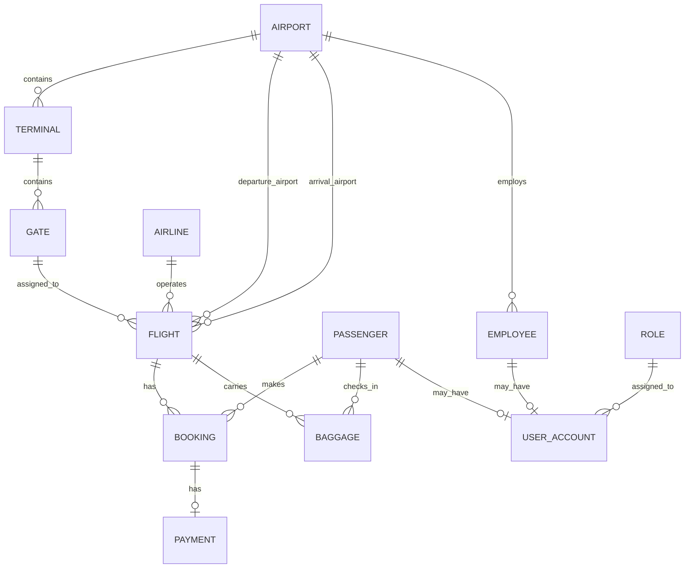
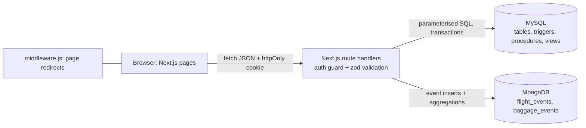

# SkyDesk – Airport Management System

**Project documentation**  
**Course:** Database Management System  
**Team members:** Kundan (PES1UG24CS243) and Vikas (PES1UG24CS915)  
**Technology stack:** Next.js · MySQL · MongoDB

> This project includes the Next.js application, MySQL and MongoDB assets, setup scripts, and project documentation. Local secrets and generated dependency/build directories are excluded from version control.

## 1. Problem statement
Airports juggle flight schedules, gate allocation, ticketing and baggage in loosely connected systems. Flights get oversold, gates get double-booked, refunds are processed by hand and bags have no trail. SkyDesk joins these in one system where **the database itself enforces the business rules**, so wrong data cannot get in through any screen or script. It goes beyond CRUD: seat-capacity locking, automatic refunds, baggage allowance rules, and event analytics.

## 2. Objectives
1. Model airports, terminals, gates, airlines, flights, passengers, bookings, payments, baggage, employees and accounts in a normalised schema.
2. Enforce operational rules in the database (capacity, gate clash, refund, baggage allowance).
3. Keep high-volume event history (flight events, baggage scans) in a store suited to it (MongoDB).
4. Provide role-based web access for passengers and airport staff.

## 3. Scope
**In:** flight search and management, booking with simulated payment, cancellation with refund, gate assignment, delay recording, baggage check-in and tracking, dashboards and analytics, authentication with two roles.
**Out:** real payment gateway, seat map, multi-leg trips, e-mail/SMS, immigration data.

## 4. Functional requirements
| ID | Requirement | Role |
|---|---|---|
| FR1 | Register, sign in, sign out | All |
| FR2 | Search flights by route, date, airline, status, free text; live seat availability | Both |
| FR3 | Book a seat (rows 1-40, A-F) in a class; pay now or later; fare computed in the database from the flight duration | Passenger |
| FR4 | Pay a pending booking; cancel a booking (refund automatic) | Passenger |
| FR5 | View and cancel any booking | Admin |
| FR6 | Create flights; change status; assign gates; record delays with reasons | Admin |
| FR7 | Check in bags against a confirmed booking; scan at checkpoints; view scan trail (passengers see their own) | Admin / Passenger |
| FR8 | Dashboards: KPIs, next departures, airline performance, busiest routes, daily sales, delay analytics | Admin |

## 5. ER diagram
The following entity-relationship overview summarizes the main entities and their relationships.



Implemented as drawn: Airport 1:M Terminal 1:M Gate 1:M Flight; Airline 1:M Flight; Flight has two relationships to Airport (departure, arrival); Passenger 1:M Booking M:1 Flight; Booking 1:1 Payment; Passenger 1:M Baggage M:1 Flight; Airport 1:M Employee; Role 1:M User_Account; User_Account 0..1 Employee and 0..1 Passenger.

**The ER diagram presents the main entities and relationships; it does not display every table attribute. The detailed attributes, primary keys, foreign keys, and constraints are described in the data dictionary and SQL schema.** Additional implementation details are handled as follows:
| Need | How it is handled |
|---|---|
| Flight fare (no fare column) | Calculated by function `fn_ticket_price`: Rs 500 + Rs 40 per minute of flight time, × class multiplier (economy 1, business 2.5, first 4). The result is stored in `PAYMENT.Amount`. |
| Seat capacity (no seats column) | Fixed aircraft layout: 40 rows × 6 seats (A-F) = 240 seats, from `fn_flight_capacity()` and a CHECK on `BOOKING.Seat_Number`. |
| One live booking per seat | Trigger `booking_validate` with a row lock on the flight. |
| `USER_ACCOUNT`: both 0..1 links | `CHECK ((employee_id IS NULL) <> (passenger_id IS NULL))`: an account belongs to exactly one kind of person. |

## 6. Relational schema
The relational design is implemented in `sql/01_schema.sql`. Primary keys uniquely identify records; foreign keys connect dependent records and enforce referential integrity.

```text
AIRPORT(airport_id PK, airport_code, airport_name, city, country)
TERMINAL(terminal_id PK, airport_id FK, terminal_name)
GATE(gate_id PK, terminal_id FK, gate_number, gate_status)
AIRLINE(airline_id PK, airline_code, airline_name, country)
FLIGHT(flight_id PK, flight_number, airline_id FK, departure_airport_id FK,
       arrival_airport_id FK, gate_id FK, scheduled_departure,
       scheduled_arrival, flight_status)
PASSENGER(passenger_id PK, first_name, last_name, date_of_birth,
          passport_number, phone, email)
BOOKING(booking_id PK, passenger_id FK, flight_id FK, booking_date,
        seat_number, travel_class, booking_status)
PAYMENT(payment_id PK, booking_id FK UNIQUE, amount, payment_method,
        payment_date, payment_status, transaction_reference)
BAGGAGE(baggage_id PK, passenger_id FK, flight_id FK, baggage_tag,
        weight, baggage_status)
ROLE(role_id PK, role_name, description)
EMPLOYEE(employee_id PK, airport_id FK, first_name, last_name,
         role_title, department, phone, email, hire_date)
USER_ACCOUNT(user_id PK, role_id FK, employee_id FK UNIQUE NULL,
             passenger_id FK UNIQUE NULL, username, email, password_hash,
             account_status, created_at)
```

**Normalisation (3NF):** non-key attributes depend on their table's key. Airport names and city information are maintained only in `airport`. The `flight` table references `airport` through separate `departure_airport_id` and `arrival_airport_id` foreign keys, avoiding duplication of airport details. Seat availability is derived (`fn_available_seats`, view `v_flight_board`) rather than stored, so it cannot drift. `payment.amount` is stored deliberately: the price paid is a historical fact that must survive later fare changes.

## 7. Database choice and justification
| Paradigm | Used for | Justification |
|---|---|---|
| **SQL: MySQL 8 (InnoDB)** | Flights, bookings, payments, passengers, gates, baggage status, accounts | The data is highly relational (a booking must reference a real passenger and flight). Money and seats need ACID transactions and row locking, which InnoDB provides. MySQL 8 adds enforced CHECK constraints, triggers, stored procedures/functions, views, window functions and FULLTEXT indexes, covering every SQL feature the course asks for. It is one of the two SQL databases named in the brief. |
| **NoSQL: MongoDB** | `flight_events`, `baggage_events` | Append-only events whose fields differ by type, no joins, unbounded growth, and aggregation pipelines for delay and throughput analytics. Keeps bulky history out of the booking database. |
| Vector DB | Not used | Optional in the course brief; the project has no unstructured text needing similarity search, so it would not be justified. |

**MySQL-specific design decision.** MySQL has no *partial* unique index, so "a seat can be held by only one live booking, but can be re-booked after a cancellation" is enforced in trigger `booking_validate`. The trigger first locks the flight row (`SELECT … FOR UPDATE`), so two simultaneous bookings of the same seat are processed one after the other and the second one is refused.

## 8. Data dictionary
PK primary key · FK foreign key · UQ unique · NN not null.

**airport** `airport_id` INT PK AUTO_INCREMENT · `airport_code` CHAR(3) UQ NN, CHECK `^[A-Z]{3}$` · FULLTEXT(airport_name, city) · `airport_name` VARCHAR(100) NN · `city` VARCHAR(60) NN · `country` VARCHAR(60) NN
**terminal** `terminal_id` PK · `airport_id` FK→airport CASCADE · `terminal_name` VARCHAR(30) · UQ(airport_id, terminal_name)
**gate** `gate_id` PK · `terminal_id` FK→terminal CASCADE · `gate_number` VARCHAR(10) · `gate_status` IN (AVAILABLE, OCCUPIED, MAINTENANCE, CLOSED) · UQ(terminal_id, gate_number)
**airline** `airline_id` PK · `airline_code` VARCHAR(3) UQ CHECK `^[A-Z0-9]{2,3}$` · `airline_name` UQ · `country`
**flight** `flight_id` PK · `flight_number` CHECK `^[A-Z0-9]{2}[0-9]{1,4}$` · `airline_id` FK RESTRICT · `departure_airport_id`, `arrival_airport_id` FK→airport RESTRICT · `gate_id` FK→gate SET NULL · `scheduled_departure`, `scheduled_arrival` DATETIME (UTC) NN · `flight_status` IN (SCHEDULED, BOARDING, DEPARTED, ARRIVED, DELAYED, CANCELLED) · CHECK departure≠arrival, arrival>departure · UQ(flight_number, scheduled_departure)
**passenger** `passenger_id` PK · `first_name`, `last_name` NN non-blank · `date_of_birth` DATE > 1900 (trigger: not in future) · `passport_number` UQ CHECK `^[A-Z0-9]{6,12}$` · `phone` CHECK `^\+?[0-9]{7,15}$` · `email` UQ CHECK e-mail pattern
**booking** `booking_id` PK · `passenger_id` FK RESTRICT · `flight_id` FK RESTRICT · `booking_date` default now() · `seat_number` VARCHAR(3) CHECK `^[0-9]{1,2}[A-F]$` and row 1..40 (`ck_seat_row`) · `travel_class` IN (ECONOMY, BUSINESS, FIRST) · `booking_status` IN (PENDING, CONFIRMED, CANCELLED) · seat and passenger uniqueness among live bookings enforced by trigger `booking_validate`
**payment** `payment_id` PK · `booking_id` FK→booking UQ (1:1) CASCADE · `amount` DECIMAL(10,2) > 0 · `payment_method` IN (CARD, UPI, NET_BANKING, CASH, WALLET) · `payment_date` DATETIME (set by `sp_process_payment`) · `payment_status` IN (PENDING, SUCCESS, FAILED, REFUNDED) · `transaction_reference` UQ generated (default expression)
**baggage** `baggage_id` PK · `passenger_id`, `flight_id` FK RESTRICT · `baggage_tag` UQ default `BG` + 8 hex characters · `weight` DECIMAL(5,2) 0<w≤50 · `baggage_status` IN (CHECKED_IN, SECURITY_SCREENED, LOADED, IN_TRANSIT, ARRIVED, CLAIMED, LOST)
**role** `role_id` PK · `role_name` UQ IN (ADMIN, PASSENGER) · `description`
**employee** `employee_id` PK · `airport_id` FK RESTRICT · names · `role_title` · `department` · `phone` CHECK · `email` UQ CHECK · `hire_date` > 1970
**user_account** `user_id` PK · `role_id` FK RESTRICT · `employee_id` FK UQ NULL · `passenger_id` FK UQ NULL · `username` UQ CHECK `^[a-zA-Z0-9_.]{4,40}$` · `email` UQ · `password_hash` (bcrypt) · `account_status` IN (ACTIVE, LOCKED, DISABLED) · `created_at` · CHECK exactly one of employee_id / passenger_id

## 9. Implementation: how each course requirement is met
| Requirement in the brief | Where |
|---|---|
| ER diagram → relational schema | §5, §6 |
| CREATE / ALTER / DROP | `01_schema.sql`: drop-and-recreate block, `ALTER TABLE booking ADD CONSTRAINT ck_seat_row`, scratch table showing add/rename/drop column, add/drop constraint, `DROP TABLE` |
| Primary and foreign keys, constraints | `01_schema.sql`: CHECKs, UNIQUE, composite keys, ON DELETE rules |
| Indexes | `idx_flight_route` (composite), `idx_flight_status`, `idx_flight_gate_time`, `idx_booking_*`, `idx_baggage_*`, `idx_booking_seat`, `idx_payment_status`, `FULLTEXT ft_airport`; `EXPLAIN` demo in `05_queries.sql` Q10 |
| Views | `v_flight_board`, `v_booking_details`, `v_baggage_tracking`, `v_airline_performance`, `v_dashboard_kpis` |
| DML (INSERT/UPDATE/DELETE/SELECT) | `04_seed.sql`, `05_queries.sql` (INSERT/UPDATE/DELETE demos), every API route |
| JOIN, GROUP BY, HAVING, ORDER BY, aggregates, subqueries | `05_queries.sql` Q1-Q10 (also CTE and correlated subquery) |
| **Advanced concepts (≥4; 7 shown)** | **1 Transactions** `sp_book_flight` (START TRANSACTION / COMMIT / exit handler ROLLBACK), API `tx()`, SAVEPOINT demo in `06_transaction_demos.sql` · **2 Views** · **3 Stored procedures/functions** procedures `sp_book_flight`, `sp_process_payment`, `sp_cancel_booking`, `sp_check_flight`; functions `fn_ticket_price`, `fn_available_seats`, `fn_flight_capacity`, `fn_class_multiplier`, `fn_baggage_allowance` · **4 Triggers** (8 objects, below) · **5 Indexing** · **6 Full-text search** (`FULLTEXT` index + `MATCH … AGAINST`) · **7 NoSQL aggregation** (3 pipelines) |
| Next.js interface with forms, tables, search, filters, dashboards | 8 pages in `src/app` |
| Backend/API layer, env vars, no hard-coded secrets | `src/app/api/**`, `.env.example` |
| Authentication, ≥2 roles | ADMIN, PASSENGER; JWT cookie; `route()` guard and `middleware.js` |
| Data validation at database level | CHECK constraints and triggers; API shows the database's error message |
| Security | bcrypt, parameterised SQL, httpOnly cookie, role checks |
| Project documentation | This document, `TEST_CASES.md`, and the repository `README.md` |

### The triggers (8 trigger objects, 7 business rules)
MySQL allows one event per trigger, so the flight rule is two triggers that share one procedure.
| # | Trigger | Rule |
|---|---|---|
| T1 | `flight_validate_ins` / `flight_validate_upd` → `sp_check_flight` | Gate must be at the departure airport and free ±60 min |
| T2 | `booking_validate` | Flight open, not departed, not full, seat free, passenger not already booked; `SELECT … FOR UPDATE` row lock makes this safe under concurrency |
| T3 | `payment_after_update` | Successful payment confirms the booking |
| T4 | `booking_after_cancel` | Cancelled booking → paid payment REFUNDED, pending payment FAILED |
| T5 | `flight_cancel_cascade` | Cancelled flight → all live bookings cancelled (then T4) |
| T6 | `baggage_validate` | Needs a confirmed booking; total weight ≤ class allowance (30/40/50 kg) |
| T7 | `passenger_validate` | Date of birth cannot be in the future (MySQL CHECK may not use `CURDATE()`) |

Errors are raised with `SIGNAL SQLSTATE '45000'` (rule broken) or `'45001'` (conflict, such as a taken seat) and a message; the API shows the message and returns 400 or 409.

## 10. Important queries
The application implementation includes flight search with availability (view + ORDER BY); airline revenue analysis (`GROUP BY … HAVING`); half-empty flight analysis (subquery); above-average spender analysis (correlated subquery); baggage per flight (LEFT JOIN + aggregates); busiest routes (CTE + window function); airport full-text search; KPI and performance views; and an indexed-search `EXPLAIN` demonstration. MongoDB aggregation use cases include delay per airline, delay reasons, baggage trail, checkpoint throughput, and validator testing. The underlying SQL and MongoDB scripts are maintained with the application source and are not included in this documentation-only repository.

## 11. System architecture

Example: admin records a delay → `PATCH /api/flights/:id` → role check → SQL transaction (times, status; T1 checks gate) → commit → `DELAY` event saved in MongoDB → shows in analytics.

## 12. Application screenshots
The `docs/images/` directory contains the ER diagram and relational schema diagrams. Application screenshots are not currently included. For a complete project demonstration, useful screenshots include the login page, passenger dashboard, filtered flight board, booking flow, baggage tracking trail, flight operations page, and analytics dashboard.

## 13. Testing overview
The test plan is documented in [`TEST_CASES.md`](TEST_CASES.md). It contains 17 API test cases and 9 manual/database test cases. Test outcomes have intentionally not been pre-filled; record the actual result only after executing each test against the project environment. The API smoke-test runner and database scripts are included in the project.

## 14. Conclusion and future enhancements
Putting rules in the database (constraints, triggers, procedures) keeps the application thin and the data consistent no matter which client writes to it, and MongoDB takes the event history that does not belong in a transactional schema. Future work: real payment gateway, seat map, caching of the departure board, change-data-capture instead of writing events from the API, row-level security, a vector search over passenger feedback, CI that runs the API tests against a throw-away database.

## Team contribution
The project was developed by Kundan (PES1UG24CS243) and Vikas (PES1UG24CS915).


---

*Repository scope: this project repository contains the application source, database assets, setup scripts, and documentation. Local secrets and generated files are excluded.*
